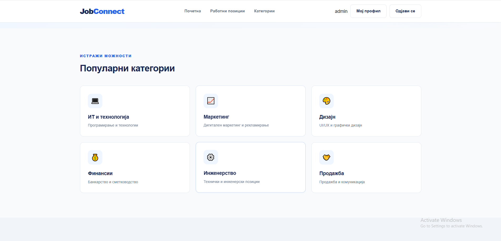
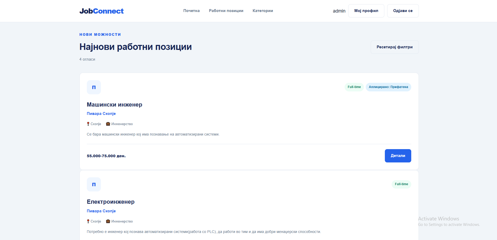
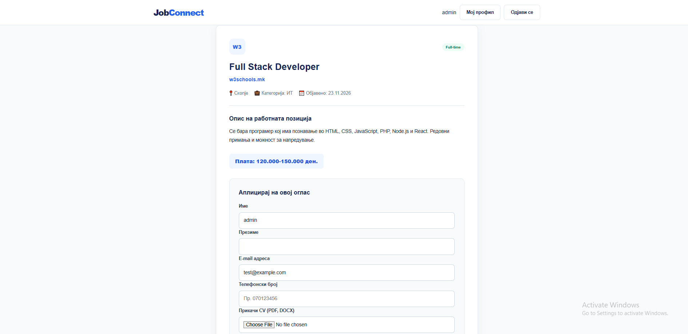
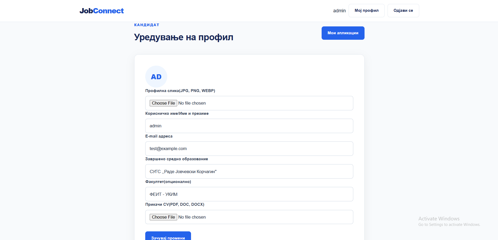
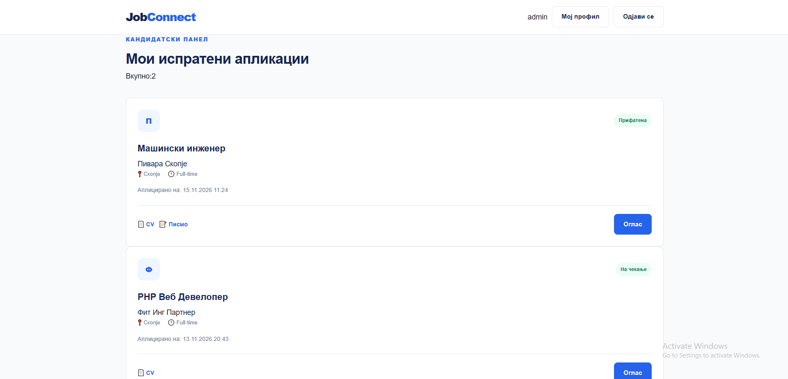
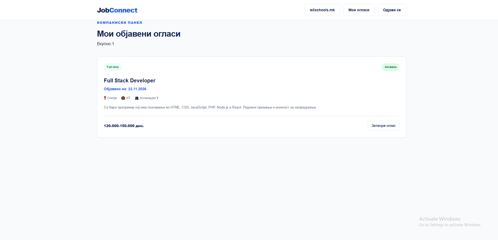
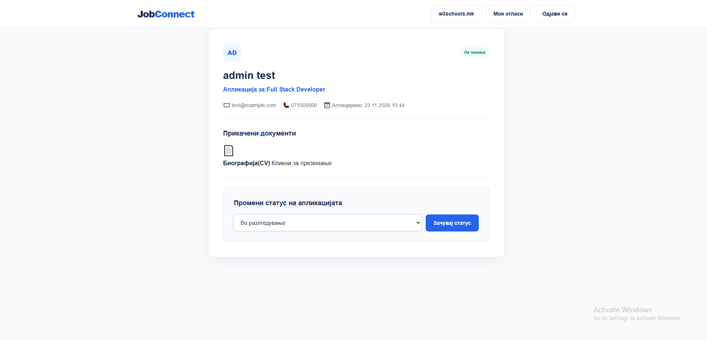
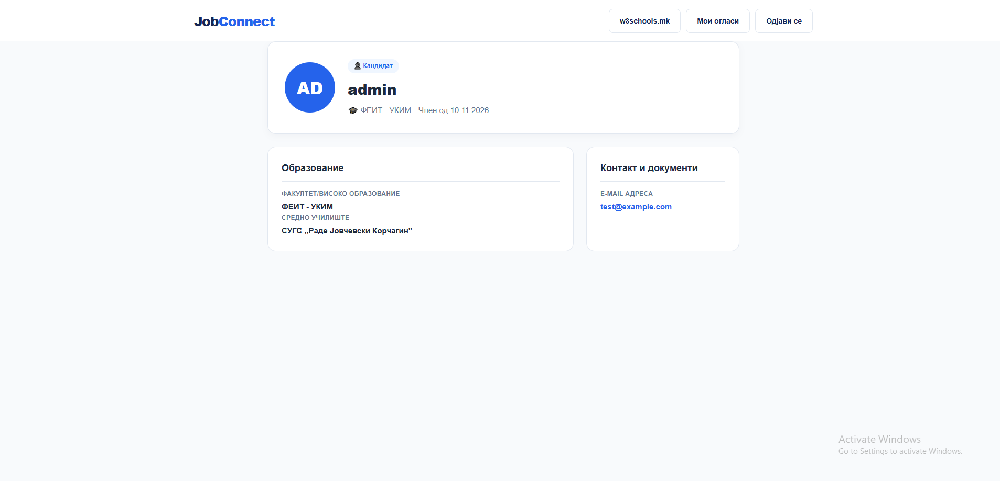
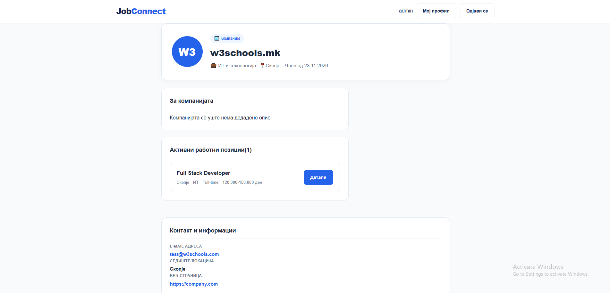

# 💼 Job Connect

Job Connect is a web application where companies can hire talent and candidates that can apply for compatible jobs.

---

## 📌 Main functions
- User registration and login for companies and candidates
- Applying for jobs
- Hiring talent
- Profile editing
- Password reset

---

## 🛠 Used technologies
- HTML5
- CSS3
- JavaScript
- PHP
- MySQL
- XAMPP

---

## 📷 Screenshots

### Home Page

---

### Categories Section

---

### Job Section

---

### Job Details

---

### My Profile

---

### Dashboard

---

### Company Home Page

---

### Company Dashboard

---

### My Company
![My Company](Screenshots/myCompany.png

---

### Application section

---

### Application details

---

### Profile Candidate

---

### Profile Company

---

## ⚙️ Installation
1. Copy the repository
2. Paste it in the folder `xampp/htdocs`
3. Start Apache and mySQL
4. Upload the database `jobconnect.sql` in phpMyAdmin
5. Open: http://localhost/JobConnect/index.php

---

## 📂 Project Structure
JobConnect
│
├── README.md
├── Database
│   └── jobconnect.sql
├── Screenshots
│
├── Source
    ├── config
    │   └── database.php
    ├── php
    │   └── application-details.php
    │   ├── create-job.php
    │   ├── dashboard.php
    │   ├── job-details.php
    │   ├── login.php
    │   ├── logout.php
    │   ├── myCompany.php
    │   ├── myProfile.php
    │   ├── navbar.php
    │   ├── profile.php
    │   ├── register.php
    │   └── test.php
    │    
    ├── script
    │   └── script.js
    ├── style
    │   ├── pages.css
    │   ├── profile.css
    │   └── style.css
    ├── uploads
    └── index.php
